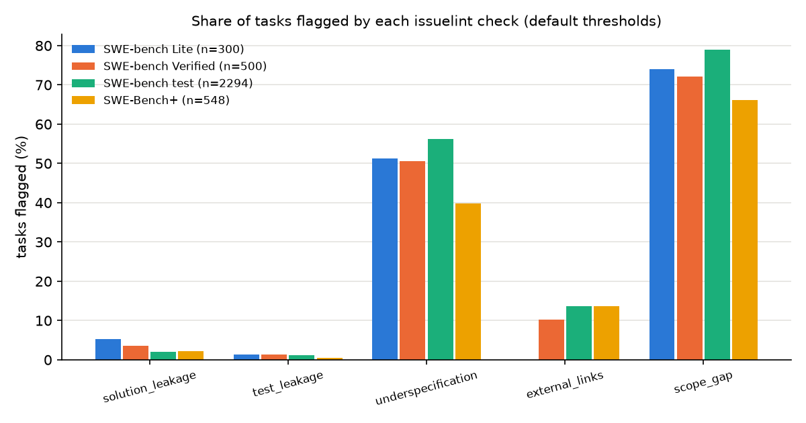

# issuelint

Check issue-to-fix task records for solution leaks, test leaks, location hints,
underspecification, external links and scope gaps before they become benchmark items.

## Why this is hard

An issue-to-fix task is only a fair test of a coding agent when the issue
text says what is wrong without saying how to fix it or how it will be
checked. An issue that pastes the fix, names the new test, or links to a
thread that holds the real description measures copying rather than
debugging; an issue with no reproduction, no expected-against-actual and no
error text leaves the task underdetermined and the gold patch becomes one
of many defensible answers. None of these properties is visible from the
patch or the issue alone: each check has to line the two up, and the useful
output is the evidence (which line, which name) rather than a verdict.

## Install

```
pip install git+https://github.com/vipul21435/issuelint
```

Python 3.10 or later, no dependencies outside the standard library. Reading
the Parquet files that SWE-bench splits are published in needs `pyarrow`:

```
pip install "issuelint[parquet] @ git+https://github.com/vipul21435/issuelint"
```

## Quickstart

Input is a `.jsonl` (one object per line), `.json` or `.parquet` file. Each
record has an issue, a gold patch and, optionally, a test patch and hints;
both the plain keys (`id`, `issue`, `patch`, `test_patch`, `hints`) and the
SWE-bench keys (`instance_id`, `problem_statement`, `patch`, `test_patch`,
`hints_text`) are read, so a SWE-bench split downloaded from Hugging Face is
checked as it is.

```
$ issuelint check examples/sample.jsonl
id              solution     tests  location underspec     links     scope  flags
clean-1            0.00      0.00      0.50      0.00      0.00      0.00   0
leaky-solution     1.00*     0.00      0.50      0.00      0.00      0.00   1
leaky-tests        0.00      1.00*     0.50      0.00      0.00      0.00   1
vague-link         0.00      0.00      0.00      1.00*     1.00*     1.00*  3

4 task(s)
  solution_leakage     flagged    1 ( 25.0%)  nonzero    1 ( 25.0%)  mean score 0.250
  test_leakage         flagged    1 ( 25.0%)  nonzero    1 ( 25.0%)  mean score 0.250
  location_hints       flagged    0 (  0.0%)  nonzero    3 ( 75.0%)  mean score 0.375
  underspecification   flagged    1 ( 25.0%)  nonzero    1 ( 25.0%)  mean score 0.250
  external_links       flagged    1 ( 25.0%)  nonzero    1 ( 25.0%)  mean score 0.250
  scope_gap            flagged    1 ( 25.0%)  nonzero    1 ( 25.0%)  mean score 0.250
```

A `*` marks a flagged check. `--explain` prints the evidence behind every
score; this is the block for one task:

```
$ issuelint check examples/sample.jsonl --explain --quiet
leaky-tests
       solution_leakage     0.00  0 of 9 added-code 6-grams appear in the issue's code
  FLAG test_leakage         1.00  3 of 3 (1 test names, 2 assertions) already in the issue
         - issue names the added test: test_kelvin_and_celsius
         - issue contains the added assertion: assert to_celsius(273.15, "K") == 0
         - issue contains the added assertion: assert to_celsius(20, "C") == 20
       location_hints       0.50  1 of 2 (1 files, 1 identifiers) named in the issue
         - issue names changed identifier to_celsius
       underspecification   0.00  0 of 4 specification signals missing
       external_links       0.00  no links
       scope_gap            0.00  0 of 1 changed identifiers never mentioned in the issue
```

`--flagged-only` limits `--explain` to flagged tasks. `--json FILE` and
`--csv FILE` write the same findings as data (the JSON
also carries the counts behind every score); `--markdown FILE` writes the
per-check shares with example ids; `--examples N` adds up to N example ids
per check to the printed summary; `--with-hints` reads the hints together
with the issue; `--limit N` checks the first N records; `--fail-on-flag`
exits 1 when any check other than `location_hints` flags a task. Every
cut-off is a flag (`--ngram`, `--solution-leakage`, `--test-leakage`,
`--underspecification`, `--scope-gap`, `--min-issue-tokens`,
`--max-evidence`); `issuelint check --help` lists the defaults.

`issuelint agree FINDINGS.json LABELS.csv --label COLUMN --positive-at X`
compares every score and count in a `check --json` file with a numeric
human label per task (see "Agreement with human labels" below).

From Python:

```python
from issuelint.checks import run_all
from issuelint.records import load_records
from issuelint.report import explain

reports = run_all(load_records("examples/sample.jsonl"))
print(explain(reports[1]))
```

`examples/run_sample.py` does the same and prints the flagged tasks and the
Markdown summary; `examples/swebench_analysis.py` produces the results
section below.

## How it works

Each check lines the issue text up against the gold patch or the test patch
and returns a score in [0, 1], a flag (`score >= threshold`), the counts
behind the score and evidence lines. Nothing is learned; every rule is below.

**Parsing.** Patches are parsed as unified diffs into files, added lines,
removed lines and hunk context headers. Paths under `tests/`, `test/`,
`__tests__/`, `spec/` or named `test_*`, `*_test.*`, `*.test.*`, `*.spec.*`
count as test files. Issue code is the content of fenced blocks, indented
blocks of two or more lines, and single-backtick spans. Tokens are
identifiers, numbers and punctuation with whitespace dropped and single and
double quotes merged, so reformatting does not break a match.

**Why these six.** The SWE-bench paper (Jimenez et al., "SWE-bench: Can
Language Models Resolve Real-World GitHub Issues?", ICLR 2024,
[arXiv 2310.06770](https://arxiv.org/abs/2310.06770)) builds tasks from an
issue, the fix in the linked pull request and the tests that pull request
adds; every check here reads one pair out of those three texts. The SWE-bench
Verified annotation instructions (published by OpenAI with SWE-bench
Verified, [PDF](https://cdn.openai.com/introducing-swe-bench-verified/swe-b-annotation-instructions.pdf))
ask annotators whether the issue is well specified "without further
information", tell them not to follow external links, and name tests that
rely on "a new function, variable name, or error message" introduced by the
gold patch and absent from the issue as the most common test problem.
SWE-Bench+ (Aleithan et al., "SWE-Bench+: Enhanced Coding Benchmark for
LLMs", [arXiv 2410.06992](https://arxiv.org/abs/2410.06992)) defines
solution leakage as the fix being given in the issue or its comments. The
SWE-bench Lite filters ([swebench.com/lite](https://www.swebench.com/lite.html))
drop issues with external hyperlinks or fewer than 40 words, which is where
`external_links` and the default `--min-issue-tokens 40` come from.

| check | score | default threshold |
| --- | --- | --- |
| `solution_leakage` | share of the token n-grams (n = 6) of the gold patch's new code lines that also occur in the issue's code | 0.2 |
| `test_leakage` | share of (test names + assertion lines) the test patch adds that the issue names (name as a whole word) or contains (every n-gram of the assertion); test names also come from `FAIL_TO_PASS` when the record has it | 0.34 |
| `location_hints` | share of (changed non-test files + changed identifiers) the issue names; a file counts when its path, a path suffix or its basename appears | never flagged |
| `underspecification` | missing signals out of four: a reproduction (a code block or words such as "reproduce", "steps to"), expected-against-actual wording, error text (a traceback, exception or error name), and a length of at least 40 tokens | 0.5 |
| `external_links` | 1.0 when the issue has links and no code block or error text of its own, 0.5 with links beside its own evidence, 0 without links | 1.0 |
| `scope_gap` | share of identifiers the gold patch changes (hunk context definitions plus added or removed `def`, `class`, `function`, `fn`, `struct`, `func` and similar lines in non-test files) that the issue never mentions | 0.5 |

Details that matter on real issues:

- *Solution leakage* counts only new code. Comment and blank lines are
  dropped; an added line whose tokens equal a removed line's (moved or
  re-indented code) is dropped; n-grams in which fewer than half of the
  tokens are identifiers (`) ) , 0 ] )`) are dropped. On the issue side, the
  source lines a traceback quotes (the line after `File "...", line N`,
  IPython's numbered lines, pytest's `>` lines) are dropped, because they
  show the code before the fix. With `S` the n-grams of the new code and `I`
  those of the issue's code, the score is `|{g in S : g in I}| / |S|`, with
  repeats in `S` counted.
- *Test leakage* matches whole assertion lines, so all n-grams of an
  assertion must occur in the issue, not only the identifier-heavy ones.
- *Scope gap* also reports, without changing its score,
  `tests_use_new_names`: identifiers (three characters or more) on the gold
  patch's added code lines and on none of its removed lines, used on the
  test patch's added lines, and absent from the issue. This is the test
  problem the Verified instructions describe.
- *Location hints* are reported and never flagged: naming the file or the
  function is normal in a good bug report, but it is worth knowing how much
  of the search the issue already did.
- `--with-hints` appends SWE-bench's `hints_text` (issue comments made before
  the fix) to the issue, which matches the SWE-Bench+ definition of leakage
  in "the issue or its comments".

**Agreement with human labels.** `issuelint agree` reads a `check --json`
file and a CSV with one numeric label per task, marks a task positive when
its label is at least `--positive-at`, and reports for every score and
count the area under the ROC curve: with `P` positives and `N` negatives
and `R` the sum of the positives' average ranks among all scores,
`AUC = (R - P(P + 1)/2) / (P N)`, the chance that a random positive scores
above a random negative (ties count one half; 0.5 is chance). The 95 %
interval is a percentile bootstrap over tasks (1000 resamples, seed 0). For
flagging checks it also prints the share flagged among positives and among
negatives.

## Results on real public data

All numbers below come from runs made for this README on 2026-11-06 with
the default thresholds; `docs/results.md` holds the full tables with
example ids and `docs/signal_shares.png` the chart.

**Data.** Downloaded by hand into a directory outside the repository; no
dataset text is committed, only counts, shares and instance ids.

| data | rows | source | licence as checked |
| --- | ---: | --- | --- |
| SWE-bench Lite, test | 300 | [princeton-nlp/SWE-bench_Lite](https://huggingface.co/datasets/princeton-nlp/SWE-bench_Lite) | the dataset card states no licence; the SWE-bench code repository ([SWE-bench/SWE-bench](https://github.com/SWE-bench/SWE-bench)) is MIT |
| SWE-bench Verified, test | 500 | [princeton-nlp/SWE-bench_Verified](https://huggingface.co/datasets/princeton-nlp/SWE-bench_Verified) | card states no licence |
| SWE-bench, test | 2294 | [princeton-nlp/SWE-bench](https://huggingface.co/datasets/princeton-nlp/SWE-bench) | card states no licence |
| SWE-Bench+ | 548 | [Zenodo record 13879453](https://zenodo.org/records/13879453) | CC BY 4.0 |
| SWE-bench Verified annotations | 1699 labelled tasks | [annotation results](https://cdn.openai.com/introducing-swe-bench-verified/swe-bench-annotation-results.zip), file `ensembled_annotations_public.csv` | no licence stated with the file |

```
mkdir -p data/lite data/verified data/full data/swebench_plus data/annotations
HF=https://huggingface.co/datasets/princeton-nlp
curl -L -o data/lite/test.parquet $HF/SWE-bench_Lite/resolve/main/data/test-00000-of-00001.parquet
curl -L -o data/verified/test.parquet $HF/SWE-bench_Verified/resolve/main/data/test-00000-of-00001.parquet
curl -L -o data/full/test.parquet $HF/SWE-bench/resolve/main/data/test-00000-of-00001.parquet
curl -L -o data/swebench_plus/data.json \
  "https://zenodo.org/api/records/13879453/files/swe_bench+_data.json/content"
curl -L -o data/annotations/results.zip \
  https://cdn.openai.com/introducing-swe-bench-verified/swe-bench-annotation-results.zip
unzip data/annotations/results.zip -d data/annotations/results
```

**SWE-bench Lite.**

```
$ issuelint check data/lite/test.parquet --quiet --examples 3
300 task(s)
  solution_leakage     flagged   16 (  5.3%)  nonzero   24 (  8.0%)  mean score 0.035
                       e.g. django__django-14534, django__django-16255, pytest-dev__pytest-5227
  test_leakage         flagged    4 (  1.3%)  nonzero    8 (  2.7%)  mean score 0.012
                       e.g. sympy__sympy-22005, django__django-13757, django__django-15695
  location_hints       flagged    0 (  0.0%)  nonzero  126 ( 42.0%)  mean score 0.264
                       e.g. django__django-11583, django__django-12453, django__django-13321
  underspecification   flagged  154 ( 51.3%)  nonzero  244 ( 81.3%)  mean score 0.378
                       e.g. django__django-10914, django__django-11039, django__django-11099
  external_links       flagged    0 (  0.0%)  nonzero    0 (  0.0%)  mean score 0.000
  scope_gap            flagged  222 ( 74.0%)  nonzero  225 ( 75.0%)  mean score 0.703
                       e.g. astropy__astropy-12907, astropy__astropy-14365, astropy__astropy-14995
```

**All four sets** (`uv run --with matplotlib python examples/swebench_analysis.py data --out docs/results.md --chart docs/signal_shares.png`, 61 s on a laptop):

| check, tasks flagged | Lite (300) | Verified (500) | SWE-bench test (2294) | SWE-Bench+ (548) |
| --- | ---: | ---: | ---: | ---: |
| `solution_leakage` | 16 (5.3 %) | 18 (3.6 %) | 47 (2.0 %) | 12 (2.2 %) |
| `solution_leakage`, `--with-hints` | 30 (10.0 %) | 39 (7.8 %) | 120 (5.2 %) | 28 (5.1 %) |
| `test_leakage` | 4 (1.3 %) | 7 (1.4 %) | 25 (1.1 %) | 3 (0.5 %) |
| `location_hints`, score > 0 | 42.0 % | 51.0 % | 52.4 % | 46.2 % |
| `underspecification` | 154 (51.3 %) | 253 (50.6 %) | 1288 (56.1 %) | 218 (39.8 %) |
| `external_links` | 0 (0.0 %) | 51 (10.2 %) | 313 (13.6 %) | 75 (13.7 %) |
| `scope_gap` | 222 (74.0 %) | 361 (72.2 %) | 1811 (78.9 %) | 362 (66.1 %) |



What the numbers say, and what they do not:

- `external_links` flags no Lite task, as it should: Lite was built by
  removing issues with external hyperlinks. With `--with-hints` it flags 15
  Lite tasks, because the comments carry links the issue does not.
- Reading the evidence of the 16 Lite tasks flagged for solution leakage,
  14 show the issue proposing the fix code (for example a suggested line or
  a diff in the issue). Two are not leaks: in `astropy__astropy-14182` the
  patch copies the issue's reproduction into a docstring example, and in
  `sympy__sympy-15678` the patch raises an error message that the issue
  quotes. This is one reader's judgement on 16 tasks, not a measured
  precision. The moved-line and traceback rules above were added after
  reading the first version's Lite flags, so Lite is not held out for them.
- `scope_gap` flags most tasks under its default threshold of 0.5: fixes
  usually touch a helper the issue does not name. Read it as a ranking, not
  as a defect rate.

**Agreement with human labels.** The SWE-bench Verified annotations give
each of 1699 SWE-bench test tasks an `underspecified` severity and a
`false_negative` severity (tests that may reject valid solutions), 0 to 3.
Positive means severity 2 or 3. The held-out half is the tasks whose
SHA-256 of the instance id is odd; `tests_use_new_names` was designed while
looking at the even half only.

```
$ issuelint check data/full/test.parquet --quiet --json full.json
$ issuelint agree full.json data/annotations/results/ensembled_annotations_public.csv \
    --label underspecified --positive-at 2
```

| label | score or count | AUC, all 1699 (95 % interval) | AUC, held-out 866 |
| --- | --- | ---: | ---: |
| underspecified >= 2 (650 positive) | `underspecification` | 0.568 (0.541 to 0.596) | 0.577 (0.538 to 0.616) |
| | `underspecification.has_reproduction` | 0.436 (0.412 to 0.460) | 0.424 (0.391 to 0.456) |
| | `underspecification.has_expected_actual` | 0.451 (0.428 to 0.474) | 0.446 (0.411 to 0.480) |
| | `underspecification.has_error_text` | 0.496 (0.473 to 0.519) | 0.494 (0.461 to 0.527) |
| | `external_links` | 0.517 (0.493 to 0.544) | 0.504 (0.469 to 0.536) |
| false_negative >= 2 (1039 positive) | `scope_gap` | 0.520 (0.494 to 0.546) | 0.507 (0.470 to 0.543) |
| | `scope_gap.unmentioned` | 0.642 (0.614 to 0.667) | 0.645 (0.607 to 0.681) |
| | `scope_gap.tests_use_new_names` | 0.679 (0.657 to 0.702) | 0.681 (0.648 to 0.712) |
| | `solution_leakage.added_ngrams` (patch size) | 0.703 (0.678 to 0.730) | 0.715 (0.680 to 0.751) |

The underspecification score ranks human-judged underspecified issues above
the rest only a little better than chance (AUC 0.57); among its signals,
the presence of an error text carries no information about the human label
(0.50), and a reproduction and expected-against-actual wording are the
useful parts (0.44 and 0.45, below 0.5 because their presence means a
better-specified issue). For test problems, the count of new names the
tests rely on and the issue never mentions reaches 0.68 on the held-out
half, but the size of the gold patch alone reaches 0.72: on this data the
count is not better than patch size, and part of its signal is likely size.
These checks are screens that order tasks for a human reader; they do not
replace the reading.

**Comparison with SWE-Bench+.** SWE-Bench+ read the patches SWE-Agent with
GPT-4 got accepted and reports solution leakage in 18 of 54 resolved Lite
tasks (33.33 %) and 37 of 112 resolved Verified tasks (33.04 %), counting,
by manual reading, any fix clearly outlined in the issue or its comments.
Those shares are over the tasks one agent solved, a set that need not look
like the whole split; issuelint's shares are over all tasks and count code overlap
only: 16 of 300 Lite tasks from the issue alone and 30 of 300 with the
comments. As a share of the whole split, 18 of 300 is 6.0 % against
issuelint's 5.3 % (issue only) and 10.0 % (with comments), but the two
counts are not over the same tasks and SWE-Bench+ does not publish its list
of leaking instances, so the overlap could not be measured.

## Limitations

- Solution leakage sees overlap of code tokens only. A fix described in
  prose ("add a branch for kelvin"), which SWE-Bench+ counts, scores 0.
  Issue code that the patch moves into a docstring example or an error
  message the issue already quotes still counts as overlap (the two false
  flags in the Lite reading above).
- Underspecification is four keyword and length signals. Against the
  Verified annotations it reaches AUC 0.57; it is a weak screen, and
  `has_error_text` carries no information about the human label on that
  data. No model of whether the expected behaviour is clear is implemented.
- `tests_use_new_names` over-approximates "new": the patch hunks show only
  the changed lines, so a name that exists elsewhere in the file but is not
  in a removed line counts as new. On the Verified annotations it does not
  beat gold-patch size as a predictor of test problems.
- The definition patterns cover Python, JavaScript and TypeScript, Rust and
  Go. Other languages still get the n-gram checks, but `scope_gap` and the
  identifier half of `location_hints` see only hunk context headers.
- `test_leakage` reads test names from `def test_*`, `it("...")`,
  `test("...")`, `fn test_*` and `func Test*`; parametrised or generated
  tests are missed unless the record carries `FAIL_TO_PASS`. SWE-Bench+
  records have no `FAIL_TO_PASS`, so their test names come from the test
  patch only.
- Nothing is executed: no repository checkout, no test run, no check that
  the tests fail before the fix. Images in issues are not looked at.
- The overlap with the SWE-Bench+ leakage set could not be measured because
  that list of instances is not published.

## Related tools

- [commitminer](https://github.com/vipul21435/commitminer): mine and rank candidate tasks from repository history.
- [reporewind](https://github.com/vipul21435/reporewind): resolve Python fix commits into source and test patches, the input issuelint reads.
- [taskledger](https://github.com/vipul21435/taskledger): schema validation and lint rules for benchmark-task bundles.
- [graderguard](https://github.com/vipul21435/graderguard): audit graders for reward hacking and flakiness.

## Licence

MIT, see [LICENSE](LICENSE).

Built by Vipul Raj Jha · https://vipul21435.github.io
